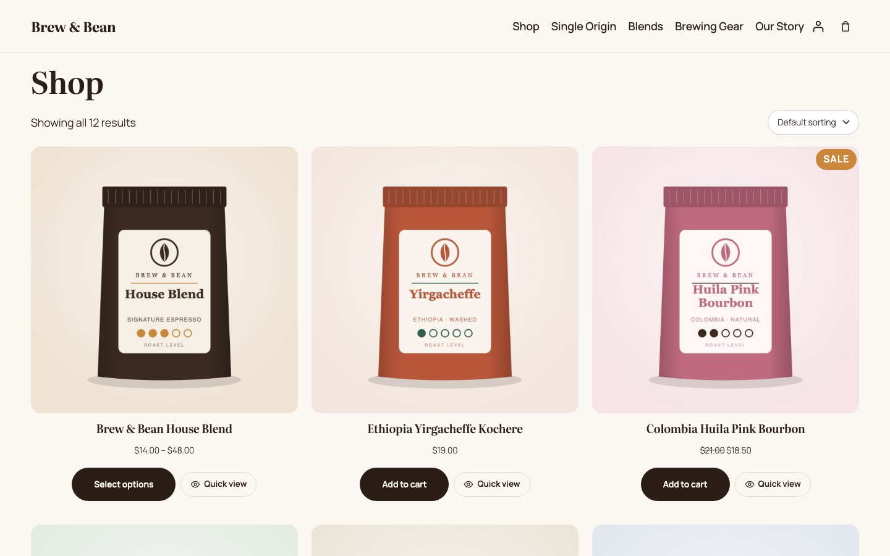
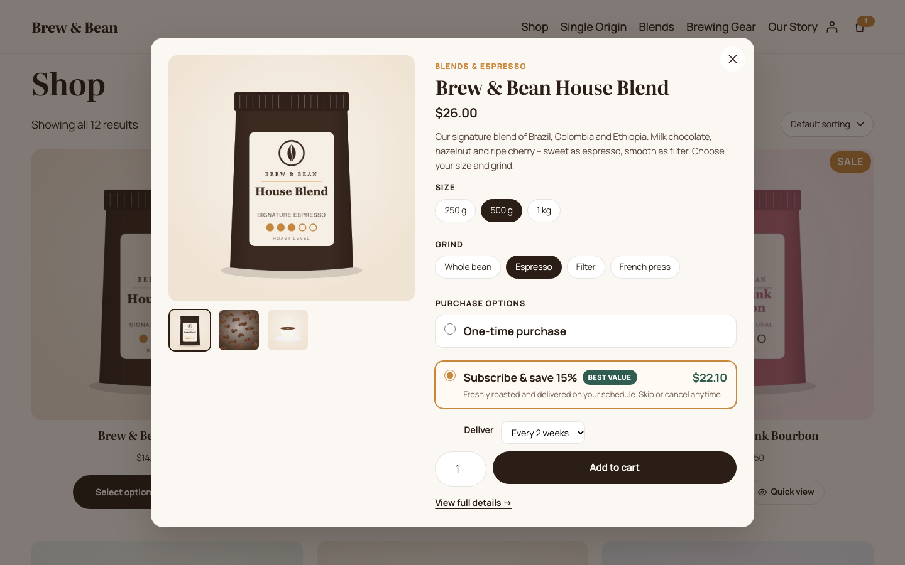
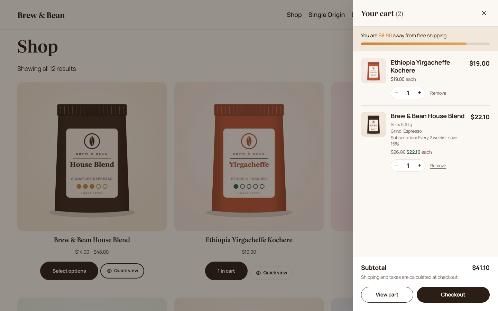
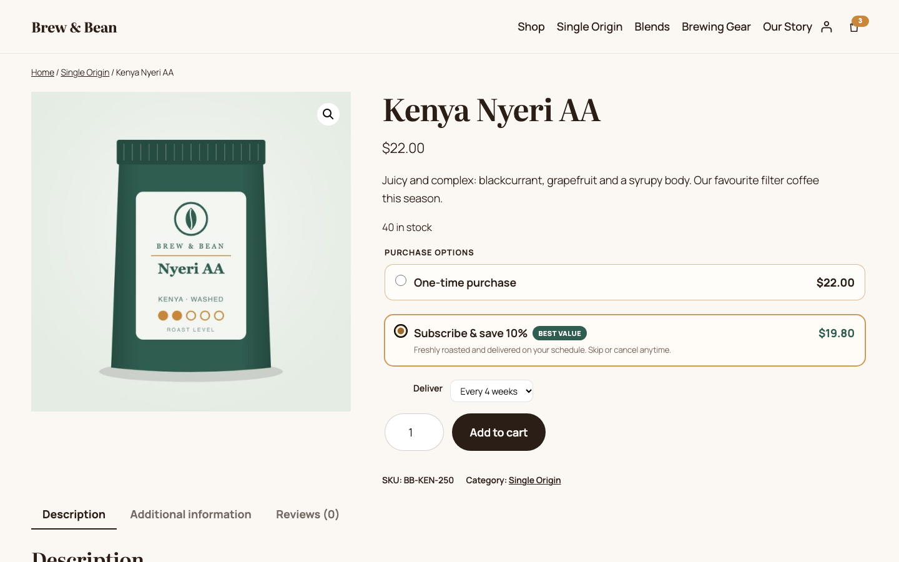
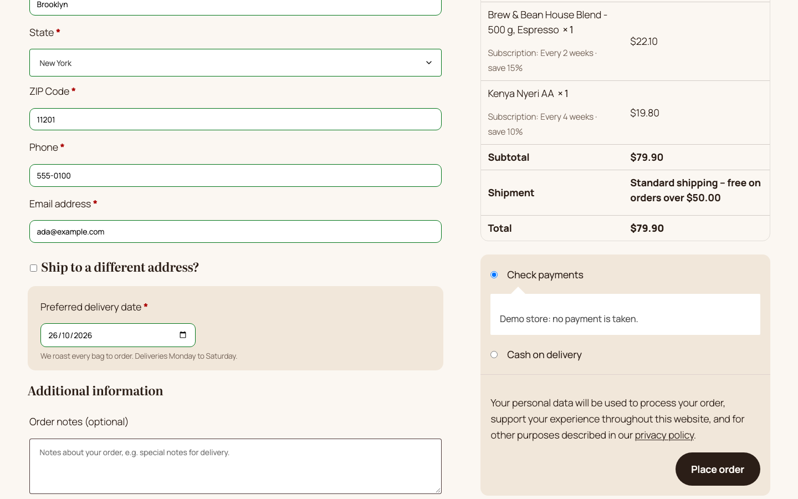
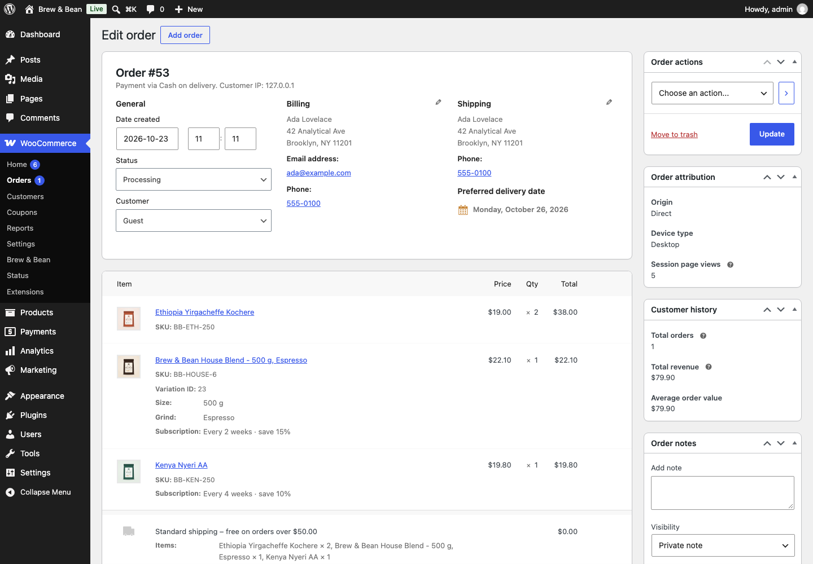
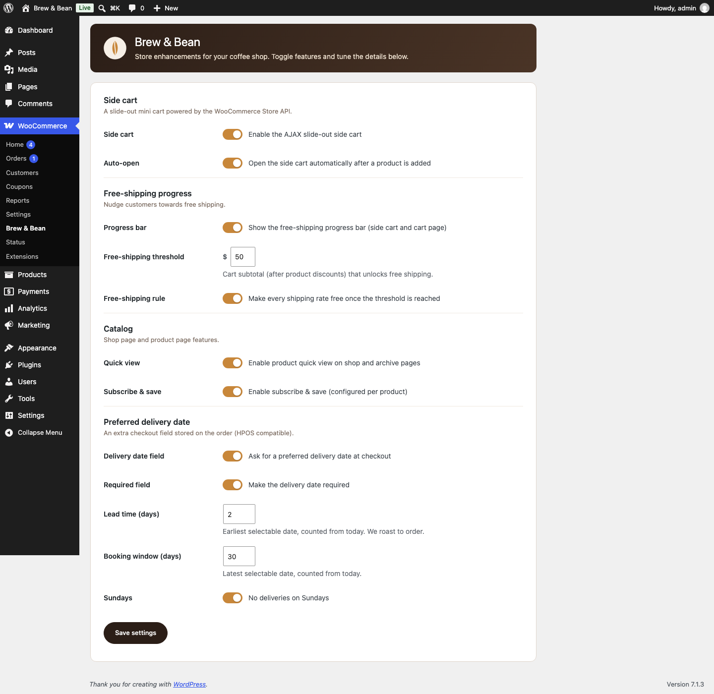
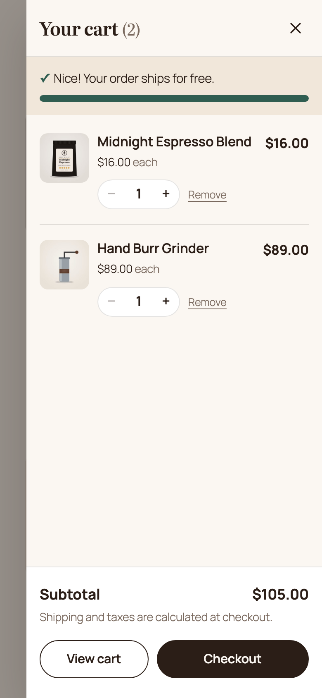

# Brew & Bean – WooCommerce Enhancements

A custom WooCommerce plugin for **Brew & Bean**, a fictional specialty coffee shop. It adds an AJAX side cart, a free-shipping progress bar, product quick view, a preferred delivery date at checkout and per-product "subscribe & save" pricing. A small Twenty Twenty-Five child theme handles the styling.

> **Demo / portfolio project.** Brew & Bean is not a real business. All products, prices and images are sample data, and the demo store takes no payments or real orders. I built it to show how I approach WooCommerce development.

[](https://playground.wordpress.net/?blueprint-url=https://raw.githubusercontent.com/yusufdeveloper2903/brewbean-woo-enhancements/main/blueprint-github.json)


**▶ [Open the live demo in WordPress Playground](https://playground.wordpress.net/?blueprint-url=https://raw.githubusercontent.com/yusufdeveloper2903/brewbean-woo-enhancements/main/blueprint-github.json)**: the whole store runs in your browser, with nothing to install. The first load takes about a minute because Playground installs WooCommerce and seeds the catalog. You are logged in as `admin`, so you can open the admin screens too.

## Screenshots

| Shop | Quick view |
| --- | --- |
|  |  |
| **Side cart + free-shipping progress** | **Product page: subscribe & save** |
|  |  |
| **Checkout: preferred delivery date** | **Admin order screen (HPOS)** |
|  |  |
| **Settings: WooCommerce → Brew & Bean** | **Mobile** |
|  |  |

## Features

### 1. AJAX slide-out side cart
- Opens automatically when a product is added from any of these places: WooCommerce's product blocks (Store API), classic AJAX buttons, the product page, or quick view.
- You can change quantities (stepper or typed value, debounced) and remove items, and the totals update live. The page never reloads.
- Built on the **WooCommerce Store API** (`/wc/store/v1/cart`, `update-item`, `remove-item`). It handles the `Nonce` header, including refreshing the nonce once when a guest session starts.
- The drawer is accessible: it is a `role="dialog"`, focus is trapped while it is open, <kbd>Esc</kbd> closes it, focus returns to the trigger, and updates are announced through `aria-live`.
- The header cart button replaces WooCommerce's auto-inserted Mini-Cart block, so the page never has two drawers. Classic themes get a floating fallback button. You can also place the button yourself with the `brewbean/cart-toggle` block or the `[brewbean_cart_toggle]` shortcode.
- After a change in the drawer, the classic cart and checkout pages are told to refresh (`wc_update_cart` / `update_checkout`).

### 2. Free-shipping progress bar
- Appears in the side cart and on the cart page (inside the classic cart form, so WooCommerce's own cart AJAX refreshes it; it is also prepended to the Cart block).
- The threshold is set in the plugin settings. The bar's data is added to the Store API cart response as `extensions.brewbean.shipping` through `woocommerce_store_api_register_endpoint_data()`.
- Optional rule: once the threshold is reached, every shipping rate becomes free (`woocommerce_package_rates`). The threshold is also added to the shipping package hash, so cached rates are recalculated when you change it.

### 3. Product quick view
- Adds a "Quick view" button to product cards: block themes get it through `render_block_woocommerce/product-button`, classic themes through `woocommerce_after_shop_loop_item`.
- The modal has an image gallery, the price, the short description, **variation swatches** (matched in vanilla JS against the product's available variations, with unavailable combinations crossed out), quantity, the subscribe & save options and add to cart.
- It is an accessible dialog: focus moves to the title, focus is trapped, <kbd>Esc</kbd>, the overlay and the close button all close it, and focus returns to the button that opened it.
- The markup comes from a theme-overridable template.

### 4. Preferred delivery date at checkout
- A native date field rendered with `woocommerce_form_field()`, with `min`/`max` set from the lead time and booking window.
- **Server-side validation:** the field is required (if set), the date format is checked, the date must fall within the lead time and booking window, and there are no Sunday deliveries. The JS hints only add convenience on top.
- The date is saved with `$order->update_meta_data()` (CRUD only, **HPOS compatible**). I verified it is stored in `wc_orders_meta`.
- It is shown on the admin order screen, in an **orders list column** (on both the HPOS and the legacy screen), on the thank-you and My Account pages, and in **order emails** (HTML and plain text, through `woocommerce_email_order_meta_fields`).

### 5. Subscribe & save (per product)
- Each product gets a **"Subscribe & save" tab in the Product data panel** (simple and variable products) with an on/off switch and a discount percentage.
- On the product page and in quick view, customers choose between a one-time purchase and subscribe & save, plus a delivery interval. Variable products show the subscription price for the selected variation.
- The choice is stored as cart item data, and the discounted price is applied in `woocommerce_before_calculate_totals`. The calculation is idempotent because it always starts from a freshly loaded product price, so the classic cart, the Store API, the side cart and checkout all agree.
- The interval is saved as order item meta (with a readable label; the internal keys are hidden).
- *Note:* the plugin records the subscription choice on the order. It does not create renewal orders; a production store would use WooCommerce Subscriptions for that.

### 6. Settings page: WooCommerce → Brew & Bean
- Built with the **Settings API**: `register_setting` with a sanitize callback, sections and fields, and `settings_fields()` for the nonce and option group.
- All values are stored in one option and sanitized per field type (checkboxes, prices through `wc_format_decimal`, and integers clamped to a range). Unknown keys are dropped, and there is a cross-field check (the booking window must be longer than the lead time).
- Shop managers can save it too (`option_page_capability_*` set to `manage_woocommerce`).
- Every feature can be switched on or off.

### Code quality
- PHP 8 with strict types, the `BrewBean\WooEnhancements` namespace, a PSR-4 style autoloader, and **one class per feature**.
- Input is sanitized (`sanitize_text_field`, `absint`, `wc_format_decimal`, `sanitize_key`) and output is escaped (`esc_html`, `esc_attr`, `esc_url`, `wp_kses_post`) everywhere.
- **i18n-ready:** text domain `brewbean-woo-enhancements`, a generated POT file in `languages/`, and JS strings through `wp.i18n` with `wp_set_script_translations`.
- The **HPOS** compatibility flag is declared through `FeaturesUtil::declare_compatibility( 'custom_order_tables' )`.
- **Vanilla JS** with no build step and no jQuery in my own code. The only exception is listening to events that WooCommerce itself only fires through jQuery (`found_variation`, `added_to_cart`).
- Front-end templates can be overridden from a theme (`yourtheme/brewbean/*.php`) through `wc_get_template()`.
- Extension points: the `brewbean_we_free_shipping_threshold` and `brewbean_we_subscription_intervals` filters, and the `brewbean_we_ajax_added_to_cart` and `brewbean_we_quick_view_before_add_to_cart` actions.

## Run it locally

You need Node.js 18 or newer. There is no PHP, MySQL or Docker to install: WordPress runs in [WordPress Playground](https://wordpress.github.io/wordpress-playground/) (PHP compiled to WebAssembly, on SQLite).

```bash
npm install
npm run dev          # starts WordPress on http://127.0.0.1:9402 (logged in as admin / password)
```

`npm run dev` mounts this folder as the plugin, mounts `theme/brewbean-coffee` as the theme, and runs [`blueprint.json`](blueprint.json). The blueprint installs WooCommerce, activates the plugin, and runs the demo seeder ([`includes/Demo/Seeder.php`](includes/Demo/Seeder.php)). The seeder sets the site title, USD currency and store address, skips WooCommerce onboarding and "coming soon" mode, enables HPOS, creates the shop, cart and checkout pages, adds a $6 flat rate, enables the cash on delivery and check payment methods, and creates **12 products** (one of them a variable product with 3 sizes × 4 grinds) with the bundled sample images, plus the categories and menu.

With the dev server running, in a second terminal:

```bash
npm run screenshots  # end-to-end walkthrough (35 checks) + regenerates docs/screenshots/*.png
npm run images       # regenerates the sample product images (SVG → JPEG, fully original artwork)
```

The screenshots script walks the full journey in Chromium: shop → quick view → add to cart → side cart → quantity change → progress bar → product page → checkout (empty date, then a Sunday, then a valid date) → order placed → admin order screen → orders list → settings save round-trip → product data tab → mobile. It fails if any check fails or if any JavaScript error is logged.

The live demo uses [`blueprint-github.json`](blueprint-github.json). It is the same blueprint, except that it installs the plugin from this repository (`git:directory`, branch `main`).

## Code structure

```
brewbean-woo-enhancements/
├── brewbean-woo-enhancements.php   # Plugin header, autoloader, HPOS declaration, bootstrap
├── includes/
│   ├── Plugin.php                  # Boots enabled features, registers shared assets, template helpers
│   ├── Settings.php                # Settings API screen (WooCommerce → Brew & Bean), sanitization
│   ├── Features/
│   │   ├── SideCart.php            # Drawer shell, header toggle block, fragments
│   │   ├── AddToCart.php           # ?wc-ajax=brewbean_add_to_cart (reuses WC_Form_Handler)
│   │   ├── ShippingProgress.php    # Progress bar, Store API extension data, free-shipping rule
│   │   ├── QuickView.php           # Card buttons + ?wc-ajax=brewbean_quick_view
│   │   ├── DeliveryDate.php        # Checkout field, validation, order meta, admin/email display
│   │   └── SubscribeSave.php       # Product data tab, purchase options, cart pricing, order item meta
│   └── Demo/Seeder.php             # Demo store content (only used by the blueprints)
├── templates/                      # Theme-overridable markup (side cart, quick view, progress bar, purchase options)
├── assets/js/                      # core.js (Store API client, helpers), side-cart.js, quick-view.js, product.js, checkout.js
├── assets/css/                     # frontend.css, admin.css
├── theme/brewbean-coffee/          # Twenty Twenty-Five child theme: theme.json palette/typography + small CSS
├── demo/                           # seed.php entry point + bundled sample images
├── languages/                      # POT file
├── tools/                          # screenshots.mjs (E2E + screenshots), generate-images.mjs
├── blueprint.json                  # Local Playground blueprint (plugin mounted)
└── blueprint-github.json           # Remote blueprint (plugin installed from GitHub)
```

## Notes and limitations

- **Classic cart and checkout.** The demo uses the `[woocommerce_cart]` and `[woocommerce_checkout]` shortcodes, because the delivery date field uses a native date picker and the classic checkout hooks. The progress bar also renders above the Cart block. Supporting the Checkout block would mean registering the field through the Additional Checkout Fields API.
- **One Playground worker.** `npm run dev` starts Playground with `--workers=1`. With several workers writing to the same SQLite database at once, I occasionally got "database disk image is malformed" errors during the test runs.
- **SQLite on Playground.** WordPress Playground runs on SQLite, which cannot run WooCommerce's checkout stock-reservation query. On SQLite only, the demo seeder adds a one-line must-use plugin that turns off checkout stock holding. MySQL sites are not affected, and the plugin itself contains no workaround.
- Subscribe & save records the plan and the discount on the order but does not bill on a schedule (see feature 5).

## Author

**Yusuf Yuldashev**, WordPress & WooCommerce developer. GitHub: [@yusufdeveloper2903](https://github.com/yusufdeveloper2903)

## License

[GPL-2.0-or-later](LICENSE). The sample product images in `demo/images` were generated for this project by [`tools/generate-images.mjs`](tools/generate-images.mjs) and use the same license.
